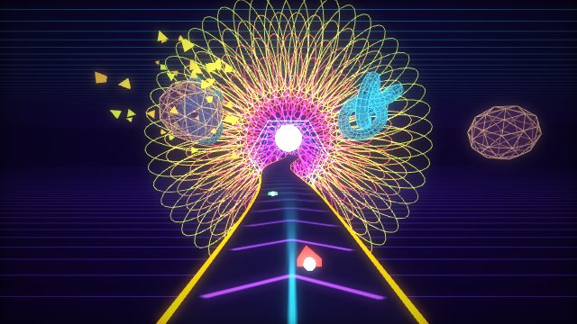
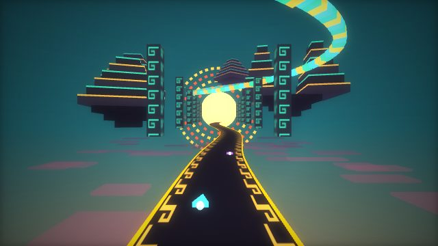
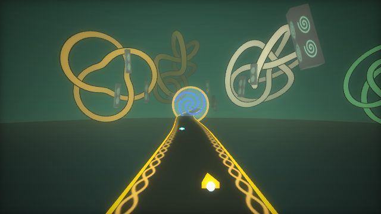
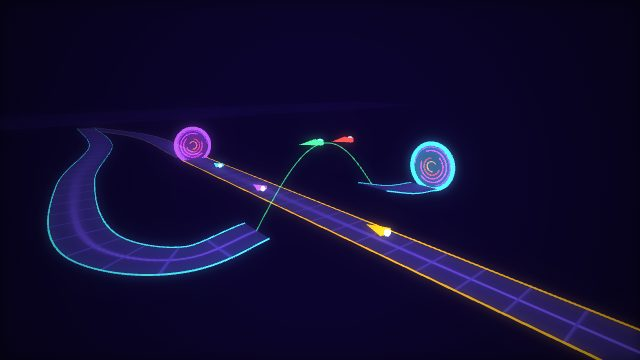

# Spirit realm: a dossier to choose from

Prototype 60, task 10. Nothing here is built. Eric picks, then a build plan follows (as Prism was picked from
mock-ups of several looks before it was built: see docs/DESIGN.md, Prism).

**How to answer:** every item has a number. Reply like "yes to 1, 9, 26, 49; no to 5; 3 but darker". A direction
(1 to 6) sets the whole look; the later sections are parts that fit most directions, so pick across them freely.
Each item says what it is, where the idea comes from, how it would be built in this engine (Three.js r128, phone
first), its **cost** (S = a day or less, M = a few days, L = a week or more) and its **phone risk** (low, medium,
high: how much it could cost frame rate on a mid-range Android phone).

**Thumbnails** (rendered with Three.js in headless Chromium; concepts, not game screenshots; the glow stands in for
the game's bloom):

| | |
| --- | --- |
|  Direction 1, Hyperspace lattice |  Direction 3, Stepped sky |
|  Direction 4, Knotwork otherworld |  Item 49, the portal jump |

There is deliberately no thumbnail for Direction 5: its shapes should come from a Coast Salish artist, not from me
(see the respectful-use section, items 72 to 79).

A note before the list. The brief is "a DMT trip", and it also names Coast Salish, Maya, Aztec and Celtic art. These
are different things. Visionary and psychedelic art (Alex Grey, Luke Brown, r/replications) is about altered states.
Coast Salish, Maya and Aztec art are living peoples' art, and presenting them as drug visions feeds an old stereotype.
So the directions keep them apart: 1 and 2 are the "trip"; 3, 4 and 5 each draw on one tradition's forms on their
own terms; 6 is a way to have several in one realm without blending them into one collage.

---

## A. Overall directions (pick one, or two for Direction 6)

**1. Hyperspace lattice (the breakthrough).** The realm people describe at a high DMT dose: a void, a lattice of
light through everything, a slowly turning many-layered mandala (McKenna's "chrysanthemum") at the vanishing point,
tunnels of rings, and watchful presences made of geometry. Grids of light far below and far above give speed a
reference without any ground. Giant wireframe solids and knots hang in the void; some shatter into shards and pull
back together. It is the closest to the house style (neon lines on black, like Prism's contour lines) and the
cheapest to make striking.
- Palette: void #07031a, violet #6a2cff, cyan #1fd6ff, gold #ffd27a, magenta #ff3fd0, a white-hot core.
- Light: no sun. Everything glows by itself; a white source sits at the centre of the mandala.
- Motion: the mandala's rings turn against each other and breathe on the kick; the grids scroll; solids rotate,
  shatter and reform.
- References: survey of 3,778 DMT reports, where fractals and geometric patterns were the most common imagery (33%)
  and "chrysanthemum" a rare named one (0.8%) ([Lawrence et al. 2022, Scientific Reports](https://www.nature.com/articles/s41598-022-11999-8.pdf));
  McKenna's chrysanthemum and hyperspace ([Chacruna](https://chacruna.net/dmt-liminality-and-hyperspace/));
  hyperbolic, wallpaper-symmetric surfaces ([QRI](https://qri.org/blog/hyperbolic-geometry-DMT)); Alex Grey's layered,
  transparent bodies and lattices of light ([Sacred Mirrors](https://humanitieshub.sdsu.edu/omeka/items/show/926),
  [bio](https://www.alexgrey.com/bio)). Take the lattice-of-light idea and the transparency; leave his figures and
  paintings.
- Build: lines (EdgesGeometry), additive rings, two GridHelper-style planes, one mandala group. Thumbnail 1.
- Cost M · Phone low.

**2. Replication (the world breathing).** Not a place but a way of seeing: the realm looks the way people describe
LSD and mushrooms changing ordinary sight. Surfaces breathe in and out, patterns crawl across them, colours drift
through the wheel, moving things leave tracers. The scenery is soft and organic: drifting clusters of fractal
fronds and coral-like branches, huge translucent cells and bubbles, a floor of slowly crawling honeycomb far below.
The effects carry the look more than the models do.
- Palette: deep teal-indigo #0d1a3a under pastel neon: peach #ffb38a, mint #7dffc4, lilac #c9a0ff, sky #8ad8ff,
  all drifting in hue.
- Light: soft and from within; a faint iridescent sheen on everything.
- Motion: everything breathes (a slow scale or vertex wave), patterns drift, hue drifts, tracers on fast objects.
- References: r/replications and the Effect Index's replications and effect definitions: breathing, drifting,
  colour shifting, tracers, geometry ([r/replications](https://www.reddit.com/r/replications/),
  [Effect Index](https://effectindex.com/replications), [PsychonautWiki: drifting](https://psychonautwiki.org/wiki/Drifting),
  [PsychonautWiki: psychedelic visual effects](https://psychonautwiki.org/wiki/Visual_effects_-_Psychedelics)); the
  often-repeated (anecdotal) note that LSD geometry looks digital and psilocybin's organic; Klüver's form constants
  (tunnels, spirals, lattices, cobwebs; [Wikipedia](https://en.wikipedia.org/wiki/Form_constant)). QRI's warning
  that replications look fake when many effects run at once uncoordinated
  ([QRI](https://qri.org/blog/replication-contest)) is a good rule: one or two effects at a time, in time with the music.
- Build: mostly items 62 to 71 (effects) on simple organic scenery. Must keep the road markings readable.
- Cost M · Phone medium (the effects; see section I).

**3. Stepped sky (Mesoamerican forms).** A dusk sky full of floating stepped platforms that unstack and restack in
steps, carved columns (stelae) hovering beside the road, a serpent of jade and gold segments winding through the
sky, and a low sun ringed by bands that turn in clicks. The road's edge bands carry the step-fret. Everything moves
in steps and quarter turns, like stone machinery.
- Palette: obsidian #14121c, jade #2fd6a4, turquoise #3fd8ff, gold #ffb43a, cinnabar #d8432c; sky teal to orange.
- Light: a low warm sun behind the serpent; long dusk light; jade and gold inlays glow.
- Motion: tiers slide out and back in steps, rings turn a notch on the beat, the serpent flows.
- References: the step-fret (xicalcoliuhqui), in use from before contact to today on stone, textiles and buildings,
  e.g. the fretwork at Mitla and El Tajín ([Wikipedia](https://en.wikipedia.org/wiki/Xicalcoliuhqui),
  [Aztec glyphs, Wired Humanities](https://aztecglyphs.wired-humanities.org/content/xicalcoliuhqui-tk217r));
  the light-and-shadow serpent on the stair at Chichén Itzá at the equinoxes
  ([Exploratorium](https://annex.exploratorium.edu/ancientobs/chichen/HTML/castillo.html),
  [Berkeley](https://multiverse.ssl.berkeley.edu/Calendar-in-the-Sky/Articles/the-descent-of-kukulkan)). Take the
  stepped profiles, frets, jade-and-obsidian colour, light as a serpent; leave deities, faces, glyphs and day signs.
- Build: boxes (instanced), a segmented ribbon on a spline, canvas textures for frets. Thumbnail 3.
- Cost M · Phone low.

**4. Knotwork otherworld (Celtic forms).** The otherworld of the old Irish and Welsh stories, reached through mist
and over still water: standing stones float in a green-gold haze, giant bands of interlace knot and unknot around
the road, and spiral gates (triskeles) are the portals. Calmer than 1 to 3, with a low golden sun.
- Palette: deep green-black #1b2a26, moss #6ec27a, bronze #d9a441, vellum #f1e3b8, lapis #3a6cff.
- Light: low sun through mist, soft shafts of light, bronze catching it.
- Motion: knots slowly loosen and retie, stones drift in slow orbits, spirals turn.
- References: La Tène spirals, S-curves and triskeles (from about 450 BC) and the later Insular interlace of the
  Book of Kells and Lindisfarne Gospels ([Wikipedia: Celtic art](https://en.wikipedia.org/wiki/Celtic_art),
  [J. Romilly Allen, Celtic Art in Pagan and Christian Times, Project Gutenberg](https://gutenberg.org/cache/epub/76733/pg76733-images.html));
  George Bain's construction methods (Celtic Art: The Methods of Construction, 1951). Take the spirals and the woven
  band built on a grid; leave the square "sun cross" (see 77).
- Build: torus knots and tubes, boxes with spiral textures, a ring with three spiral arms. Thumbnail 4.
- Cost M · Phone low to medium (tube triangle counts).

**5. Tide and cedar (Coast Salish forms, only with a commissioned artist).** Night on a dark sea: huge discs turn
slowly in the air like spindle whorls, cut through with circles, crescents and trigons; the cut shapes open and
close, and light shows through the negative spaces. A moon, mist, black and red and blue-green on cedar-warm and bone
white. It would be the most beautiful and the most local (Eric is in BC), and it is the one that must not be made by
imitation.
- Palette (Northwest Coast colour logic): black, red ochre, blue-green, cedar #9a5b34, bone #efe6d2, on a night sea.
- Light: moonlight and light through the cut-outs.
- Motion: discs spin; crescents open and close; positive and negative spaces swap.
- References: Coast Salish design is built from circles (ovals), crescents, extended crescents and trigons, framed
  by positive and negative space rather than outlines ([UVic Coast Salish design elements](https://legacy.uvic.ca/gallery/salishcurriculum/coast-salish-design-elements/),
  [UVic Cornett gallery](https://legacy.uvic.ca/gallery/cornett/coast-salish-art/)); Musqueam artist Susan Point
  works from these elements "like an alphabet", often in spindle-whorl form
  ([Seattle Art Museum](https://art.seattleartmuseum.org/people/13003/susan-point)). Northern formline (ovoids,
  U-forms, black primary and red secondary) is a different, more northern system
  ([Burke Museum](https://www.burkemuseum.org/static/Susan_Point_Web_Exhibit/formline.html),
  [Canadian Encyclopedia](https://www.thecanadianencyclopedia.ca/en/article/northwest-coast-aboriginal-art)).
- Build: the artist supplies a set of flat shapes (SVG) licensed for the game; the engine extrudes them and spins
  them. No crests, beings or stories unless the artist chooses to give them.
- Cost M plus a commission · Phone low.

**6. Rooms (several realms joined by portals).** Many DMT reports describe passing through distinct places or rooms.
The realm could be a chain of two or three rooms per lap, each in one direction's look (say 1 then 3 then 1, or
1, 4, 2), joined by portals (section G). Each room stays true to one source; the portal is the seam, so traditions
are never blended into one pattern. Sky, fog and palette change at each portal.
- Reference: places, objects and entities as categories in reports ([Chacruna](https://chacruna.net/dmt-liminality-and-hyperspace/)).
- Build: per-section palette and scenery sets; fog and sky colours change in the portal's flash.
- Cost L (two or three looks) · Phone low (one room drawn at a time, others culled).

---

## B. Visual motifs and sources

**7. Lattice bodies (after Alex Grey).** Floating solids drawn as a dark translucent core, bright edges and an inner
grid of light, layered so you see through them. Ref: Grey's anatomical-to-spiritual layering, e.g. the Universal
Mind Lattice ([Sacred Mirrors](https://humanitieshub.sdsu.edu/omeka/items/show/926),
[Raw Vision](https://rawvision.com/blogs/hall-of-fame/alex-grey-b-1953)). Build: mesh + EdgesGeometry lines + a
back-face core. No human figures, no copies of his images. Cost S · Phone low.

**8. Symmetric sky mural (after Luke Brown).** A dense, radially symmetric pattern on the sky, jewel colours, like a
temple map seen from inside. Ref: Luke Brown (SpectralEyes), symmetric "multidimensional cartography", OCAD
trained, worked with Meow Wolf ([Meow Wolf credits](https://credits.meowwolf.com/people/luke-brown),
[Threyda bio](https://www.threyda.com/pages/artist-bio-luke-brown)). Build: one canvas texture drawn from the track's
seed with 6- or 8-fold mirroring, on the sky dome. Take symmetry and density; never his compositions. Cost S ·
Phone low.

**9. The chrysanthemum.** Layered rings of petals at the vanishing point, each layer turning the other way, the
centre white-hot. Ref: McKenna via [Chacruna](https://chacruna.net/dmt-liminality-and-hyperspace/); "wallpaper
symmetry" stage ([QRI](https://qri.org/blog/hyperbolic-geometry-DMT)). Build: line loops in groups (thumbnail 1), or
one quad with a polar shader (one draw). Placed in the sky like the sun, so it is always ahead-ish. Cost S · Phone low.

**10. Presences (entities, abstract).** Reports often meet beings: "being, guide, spirit, alien, helper" were the
commonest words in one survey ([Davis et al. 2020](https://gwern.net/doc/psychedelic/2020-davis.pdf)). Ours have
no faces: clusters of rings and orbs that turn to follow the race leader, gather near portals, and part to let the
pack through. Friendly, not scary. Build: small groups of rings, `lookAt` the leader. Cost S · Phone low.

**11. Hyperspace tunnel.** Rings (hexagons or circles) in a long tunnel that the road runs through, colour cycling
along it. Ref: tunnel form constant ([Wikipedia](https://en.wikipedia.org/wiki/Form_constant)), DMT tunnel reports.
Build: instanced rings round the road's frame (the existing tunnels follow the road the same way). Cost S · Phone low.

**12. Hyperbolic sheets.** Ruffled, coral-like surfaces that curl away faster than a flat sheet can: frills and
saddles hanging in the void. Ref: [QRI on hyperbolic geometry](https://qri.org/blog/hyperbolic-geometry-DMT). Build:
a parametric surface with growing frills, made once per track. Cost M · Phone low.

**13. Form constants as floors.** Klüver's four (tunnel, spiral, lattice/honeycomb, cobweb) as the pattern on far
floors and walls of light. Ref: [Wikipedia](https://en.wikipedia.org/wiki/Form_constant). Build: tiling textures on
far planes. Cost S · Phone low.

**14. Sacred-geometry solids.** Platonic solids, nested polyhedra, the "flower of life" circle grid: shared,
centuries-old geometry that visionary art uses everywhere. Safe to use freely. Build: Three's polyhedra. Cost S ·
Phone low.

**15. Coast Salish elements (commission).** Circle, crescent, trigon; positive and negative space; spindle-whorl
discs. Ref: [UVic](https://legacy.uvic.ca/gallery/salishcurriculum/coast-salish-design-elements/). Build: artist's
SVG shapes, extruded. Only with Direction 5's commission. Cost M+ · Phone low.

**16. Northern formline principles (commission, or leave out).** A continuous primary line in black, red secondary,
blue-green tertiary; ovoids, U-forms and split U-forms. Note this is the northern coast's system (Haida, Tlingit,
Tsimshian and others), not Coast Salish; Eric's brief says Salish, so this is only if an artist wants it. Ref:
Bill Holm, Northwest Coast Indian Art: An Analysis of Form (1965; [Project MUSE](https://muse.jhu.edu/book/47597)),
[SFU bentwood box design elements](https://www.sfu.ca/archaeology/museum/exhibits/virtual-exhibits/north-west-coast-cedar-wood-boxes/design-element---form.html).
Cost M+ · Phone low.

**17. Step-fret bands.** The stepped spiral as a band along the road's edges, on stelae and on platform trims.
Ref: [Xicalcoliuhqui](https://en.wikipedia.org/wiki/Xicalcoliuhqui). Build: a canvas texture (thumbnail 3). Cost S ·
Phone low.

**18. Serpent of segments.** A long flying ribbon of jade, turquoise and gold blocks winding through the sky and
sometimes alongside the road. A serpent, not a named god. Build: instanced boxes along a moving spline. Cost S ·
Phone low.

**19. Stelae.** Tall carved slabs hovering beside the road in pairs, carved with abstract step patterns (no glyphs).
Build: boxes with a texture. Cost S · Phone low.

**20. Light serpent on a stair.** A stepped platform whose edge lights up in a zigzag that runs down it as the pack
passes, after the Chichén Itzá equinox shadow
([Exploratorium](https://annex.exploratorium.edu/ancientobs/chichen/HTML/castillo.html)). Build: emissive strips
lit in sequence by the leader's distance. Cost S · Phone low.

**21. Interlace bands.** Celtic knotwork as the road's edge band and as giant floating knots. Ref: Insular interlace
built from plaits with breaks (Bain; [Celtic art](https://en.wikipedia.org/wiki/Celtic_art)). Build: canvas texture
for bands, TorusKnotGeometry and tubes for the giants. Cost S · Phone low.

**22. Spirals and triskeles.** La Tène spirals and three-armed spirals as gates, as portals and on the stones.
Build: tubes along spiral curves (thumbnail 4). Cost S · Phone low.

**23. Floating standing stones.** Rough upright stones with spiral marks, drifting in slow orbits, never resting on
anything. Build: boxes with a little vertex noise, instanced. Cost S · Phone low.

---

## C. Giant floating objects

All of these are scenery only: they never touch a race, use their own clock and their own random numbers (not the
game's, as the Prototype 51 rule requires), stay outside the scenery margin round the road, and never pass through
the road. In this realm floating is the point, so no object has a base that looks like it should stand on ground.

**24. Shatter and reform.** A solid made of 50 to 300 pieces: the pieces fly out along their faces' normals, hang,
spin, and pull back together. On a timer, or on the music's drop (the engine knows when sections change). Build: one
InstancedMesh per object; each piece has a home and an outward vector, and the vertex shader moves it by one
uniform (no per-piece CPU work). Cost M · Phone low.

**25. Merge and become.** Two objects drift together and swap pieces to become a third shape (an icosahedron and a
torus become a knot), then split again. Build: as 24, with each piece's target sampled from the surface of shape A,
B or C; a uniform blends between targets. Cost M · Phone low.

**26. Unfolding solids.** A cube opens into its flat cross and refolds; a dodecahedron opens like a flower. Build:
faces as separate meshes hinged on their edges, angles animated. Cost M · Phone low.

**27. Gyroscopes.** Nested rings turning on different axes round a glowing core, hundreds of metres across. Build:
torus meshes in nested groups. Cost S · Phone low.

**28. Stacks that unstack.** Stepped platforms whose tiers slide out sideways, turn a quarter, and slide back, in
steps on the beat (Direction 3). Build: boxes, moved in quantised steps. Cost S · Phone low.

**29. Knots that untie.** A huge knot loosens into a loop and ties itself again as a different knot. Build:
precomputed morph targets on one tube (Three's morphAttributes), not a new tube every frame. Cost M · Phone low.

**30. Shoals of shapes.** Flocks of small solids wheeling round like Reef's fish shoals (that code exists). Cost S ·
Phone low.

**31. The colossus.** One vast, slow lattice presence far off the road, turning its ring "head" towards the race
over a whole lap. Lines only. Cost M · Phone low.

**32. Arches that assemble.** Pieces fly in to form an arch over the road just before the leader reaches it, and
burst apart after the last racer. Build: as 24, triggered by race positions; must be complete well before anyone
gets there. Cost M · Phone low.

**33. Pieces of the other realms.** Floating fragments of Hoverline's own worlds drift past: a chunk of Prism's
contour-lined rock, a lit city block from Urban, a coral head from Reef, a cyber-tree crown from Forest, as if the
realm were made of memories of the other tracks. Build: reuse those biomes' builders on small pieces. Cost M ·
Phone low.

---

## D. Terrain (little or none)

**34. Pure void with planes of light.** A grid far below and another far above, nothing else (thumbnail 1). Gives
speed a reference without ground. Cost S · Phone low.

**35. Pattern floor.** A far floor tiled with a form-constant pattern (13) that scrolls and slowly breathes. Use a
small repeating texture, not a procedural shader over half the screen. Cost S · Phone low (medium if done as a
shader).

**36. A sea of mist or light below.** Like Stratos' clouds below, in the realm's colour; still water for Direction 4
(thumbnail 4). Cost S · Phone low.

**37. Mirror water far below.** The floating objects reflected in still water. A true mirror is a second render of
the scene (high cost); fake it with flipped, dimmed copies of the few giant objects. Cost S (fake) · Phone low.

**38. Stars in every direction.** No up or down: stars above and below, as Stratos does at night. Cost S · Phone low.

**39. Islands.** A few floating islands of pattern (a stepped platform, a disc, a knot of stone) that the road passes
over or between, never standing on anything. Cost S · Phone low.

---

## E. The road

The colour language stays: amber edges, cyan boost, green shield strips, purple ammo strips, red for damage. The road
must stay the easiest thing on screen to read.

**40. Road of glass and light.** A dark translucent road with chevrons flowing towards you a little faster than
you travel (thumbnail 1). Cost S · Phone low.

**41. Pattern bands outside the edges.** A band of the direction's pattern (step-fret, interlace, chevrons) just
outside the amber edge line, never inside it (thumbnails 3 and 4). Cost S · Phone low.

**42. Breathing edges.** The edge lines swell on the kick; this is the existing "Lights on the beat" option, given a
softer, longer breath here. Cost S · Phone low.

**43. Road that builds itself.** Far ahead of the leader (beyond 300 m, at least 3 seconds away), the road arrives as
tiles flying into place; behind the last racer it dissolves into pieces. Near the pack it is a normal solid road.
Cost M · Phone low to medium (instanced tiles at the far end only).

**44. No pylons.** Instead of pylons, thin beams of light fall from the road's underside into the void, or nothing at
all (the road just floats, which suits the realm). Cost S · Phone low.

**45. Walls as rings.** The glass walls replaced by a row of thin ring-gates the road passes through, every 20 m.
Cost S · Phone low (instanced).

---

## F. Music

The music today is not tied to the setting: any template can play on any track. The template system (95 templates in
rotation, genre per template, likes that weight choices; docs/music-templates.md) can take a realm's lean without
any new machinery.

**46. No link.** As every other setting: any tune. Cost none.

**47. A lean, not a lock.** On realm tracks the picker weights Psytrance (8 in rotation), Trance (9), the World colour
and the slower, spacious templates up, as a like does, never ruling anything out. Needs the track's setting passed to
the picker in `023-likes.js`. Cost S · Phone none.

**48. Two or three new realm templates.** For example: a rolling 142 bpm psytrance with an off-beat bass and long
filter sweeps (Direction 1); a 110 bpm half-time with frame drums and clay-flute-like leads (Direction 3, synthesised,
no recordings of ceremonies); a trance with harp-like plucks over a frame-drum groove (Direction 4). Each goes through
the music rules: rendered, compared with the Prototype 25 baseline, fatigue audit, and "music has space" (few parts at
once). Cost M each · Phone none.

Portal sound goes with any portal (section G): a filter sweep and a reversed swell into the entrance, and the drop
landing on the exit, using the existing bus filter and section faders (see 58).

Not for use: recordings of ceremonies, icaros (Shipibo healing songs), Indigenous drum songs or chants, or anything
sampled from a living tradition's sacred music.

---

## G. Portals

How a portal works in this engine. The track is a centreline of points, and every racer's place on it is a distance
along it (`utot`), with steering, height and speed measured from it. A portal is a break in the centreline: the
point at the entrance face is followed by the point at the exit face, somewhere else. Distance along the track,
speed, sideways offset and height above the road all carry through unchanged; only the position in the world jumps.
So the AI's line, ghosts, lap counting and the simulator need nothing new, and racers on either side of a portal
never collide (they are far apart along the track). What needs work: the camera (it passes through with the racer,
moved by the same jump, so the view stays continuous), the minimap (the two pieces joined by a dashed line),
multiplayer (snap, never smooth, a remote racer across a portal), and what you see in the portal:

- (a) a swirl surface (opaque, one draw; a 0.15 s flash on crossing): cheap, all presets;
- (b) a live view: a second camera at the exit renders into a small texture (256 to 384 px) only for the nearest
  portal within 250 m. One extra low-resolution scene render per frame: about double the draw calls for those seconds.
  Default preset only ([three.js forum on portal techniques](https://discourse.threejs.org/t/how-to-create-a-portal-effect-or-how-to-fake-it/57752),
  [Sebastian Lague, Coding Adventure: Portals](https://rosetta.to/u/sebastianlague/coding-adventure-portals));
- (c) a still picture of the exit, rendered once when the track is built and shown in the portal with a swirl over
  it: almost free, and on Lite and Ultra low it replaces (b).

Rarity: one portal pair on most realm tracks, two at most, and the jump portal (49) on about one in three. The realm
gets its own track letter (S is free; U O F N R P are taken), so no existing track code changes and no board era
needs raising for other settings.

**49. The portal jump (Eric's idea), worked out.** Thumbnail "portal-jump".

```
   (top view; the main road runs up the page, racers drive up)

                 [E] entrance portal, faces the oncoming road
                  |
   landing ramp   |
   <==============+==========  ramp  <=====[X] exit portal, faces left
   (catch ramp,   |          (lip)          75 m right, 120 m before E,
    250 m, then   |                         18 m above the main road
    turns right   |
    and runs on)  |  main road: racers pass UNDER the jump here
                  |
                  ^  racers arrive
```

- Main road: a straight of at least 300 m before the entrance E. E is a ring 1.5 times the road's width, facing
  the oncoming road; the road ends in it (behind it is the portal's back, dark).
- Exit X: 75 m to the right of the main road's centreline, 120 m back down the road from E, its floor 18 m above the
  main road, facing left (at right angles to the main road; a 45° forward-left version is 50).
- Ramp: 45 m from X to a lip 30 m right of the main centreline (17 m clear of a Wide road's wall), rising 2 m, lip
  angle 6°. A launch pad on the ramp lifts anyone slower than 90 m/s to 90 m/s, so nobody falls short (a racer can
  arrive slow after a wreck).
- Flight: the lip is 20 m above the main road. At 90 m/s (the slowest, after the pad) a frame crosses the 60 m from
  the lip to the far side in 0.67 s and ends about level with the lip; at 150 m/s it rises about 4 m first. Either way
  it passes about 20 m over the main road, clear of its walls and racers by a wide margin.
- Landing: a long catch ramp starting 30 m left of the main centreline, shaped to the flight envelope from 90 to
  180 m/s (task 8's long catch jumps and the existing jump fence, which already traces the flight of a frame at 1.2
  times top speed). A frame leaving the lip at 90 m/s comes down about 130 m out, at 150 m/s about 250 m out, so
  the ramp is about 250 m long; then the road turns right and runs on beside the portal and away.
- What players see: a racer on the main road drives under the jump 120 m (under a second) before the portal, so the
  last-placed racer watches the leaders fly across overhead, then takes the same jump. A racer in the air looks down
  on the ones still coming. At 150 m/s, 120 m is 0.8 s; a gap of up to about 1.5 s between racers shows it.
- Weapons: shots and mines follow distance along the track, so nothing fired on the main road reaches the jumpers
  or the other way round. Worth a line in track info: "Portals: shots go through with you."
- Build: a centreline break in the generator, a jump with a launch pad, a catch ramp, the camera carry-through, the
  minimap link, one of the views (a/b/c). Cost L · Phone low (with c) to medium (with b).

**50. Diagonal portal jump.** As 49, but the exit faces 45° forward-left, so the jump crosses the main road on a
long diagonal: jumpers are overhead for longer, and the landing needs only a 45° turn after it. Cost (with 49) S ·
Phone same.

**51. Portal split.** The road splits; one side drives into a portal and comes out far ahead on a slower, twisty
stretch, the other runs round fast. Tuned so both take the same time at good pace (as splits are now). Overhead
signs show what each side holds (existing). Cost M · Phone low.

**52. Sky drop.** The road dips into a portal lying tilted in the road; the exit hangs in the sky, facing down at
30°, over a long landing ramp: you fall out of the sky onto the road ahead. Pairs with task 8's drops. Cost M ·
Phone low.

**53. Over-and-under.** Through a portal and out onto a road running back above the one you just drove, upside down
or right way up, so racers see each other overhead going the other way for a few hundred metres. Pairs with task 8's
road under road. Cost M · Phone low.

**54. Realm-shift portal.** The portal is a seam between rooms (Direction 6): sky, fog, palette and scenery set
change in the crossing's flash. Can sit on a normal straight, no jump needed. Cost S (given 6) · Phone low.

**55. Seeing yourself.** A portal pair placed so that, as you approach the entrance, the live view (b) shows the
road you are on from the side: you see your own frame and the pack arriving. Only with view (b). Cost S (given
b) · Phone medium.

**56. Breaking portal.** The portal's ring is one of the shatter-and-reform objects (24): it bursts apart after the
last racer each lap and reassembles before the leader comes round. Purely visual. Cost S (given 24) · Phone low.

Not recommended: a portal whose exit moves during the race. Racers pass at different times, so they would get
different jumps; unfair, and the AI and simulator would need a time-dependent track.

---

## H. Other mechanics unique to the realm

Rare, as all track features are ("all things in moderation, including moderation"). Items marked *changes races*
would make realm times their own board (realm only; other settings unaffected).

**57. Echoes of the leaders.** Faint tracers show where the racers ahead were in the last 1 to 2 seconds: a
replication that is also information. Built on the ghost code. Visual only. Cost S · Phone low.

**58. The music moves the world.** Drops trigger shatters (24), tiers step on the beat (28), presences pulse (10).
The engine already tells the loop about sections and the kick. Visual only. Cost S · Phone low.

**59. Light stream.** A stretch inside a hyperspace tunnel (11) where everyone gets a slipstream-like pull (+8% top
speed) whatever their place; reads as being carried by the realm. *Changes races.* Cost S · Phone low.

**60. Guides.** Presences (10) beside the road hand a small boost or a few ammo to racers in the back half of the
pack only. A catch-up mechanic; some players dislike those. *Changes races.* Cost S · Phone low.

**61. Wrecks dissolve.** A wrecked frame breaks into its geometry and reassembles at the respawn instead of
exploding. Visual only. Cost S · Phone low.

Considered and left out: a road that breathes in width (it changes the driving under you and would be unfair to
whoever hits the narrow phase); gates that open and close on the beat (a pure timing hazard, not racing).

---

## I. Screen and visual effects (Three.js r128 on a phone)

The game already draws through one full-screen pass when any effect is on: the scene into a buffer, bloom (a bright
pass and four small blurs at half and quarter size), then one composite shader with speed blur, colour fringing,
glitch, smoothing, grade and grain (`core/003-graphics.js`). On a phone's tiled GPU each extra full-screen pass costs
about a millisecond or more and blurs are the expensive part
([Meta: techniques to avoid on mobile](https://developers.meta.com/horizon/blog/pc-rendering-techniques-to-avoid-when-developing-for-mobile-vr/),
[Arm: post-processing for mobile, GDC 2018](https://community.arm.com/developer/tools-software/graphics/b/blog/posts/post-processing-effects-for-mobile-at-gdc18)).
The budget rule for the realm: **no new full-screen pass.** Effects go into the existing composite shader (a few
maths per pixel), into the scenery's own materials, or into geometry. Each is part of an existing option, so Lite and
Ultra low drop it with everything else.

**62. Colour drift (scenery only).** The scenery's colours, fog and sky drift slowly round the wheel, staying within
a band so the direction keeps its palette. Done on the materials from the CPU: zero GPU cost, and it never touches the
road or the cue colours (red damage, green shield). Cost S · Phone none.

**63. Breathing (screen).** A slow in-and-out warp of the picture, only towards the screen's edges (the centre, where
the road is, stays still), at a tiny amplitude, in the composite shader. Cost S · Phone low.

**64. Drifting (screen).** Low-frequency wobble at the screen's edges from a small noise texture: one extra texture
read per pixel in the composite. Cost S · Phone low to medium.

**65. Tracers.** Two ways: geometry tracers (3 to 5 fading copies of fast-moving pieces at their past positions; no
screen cost; recommended), or screen tracers (keep last frame in a half-size buffer and blend it in: one extra
half-size copy, about as dear as one bloom blur; smears the road unless masked, Default only). Cost S / M · Phone low
/ medium.

**66. Kaleidoscope crossing.** For the 0.3 s of a portal crossing, the composite mirrors the picture into six slices
and releases. Costs only while active. Cost S · Phone low.

**67. Auras.** A slightly larger back-face shell on floating objects with a glow strongest at their edges (Fresnel),
after Grey's auras. Cheap per vertex; the fill rate of big shells is the cost, so a few objects only. Cost S · Phone
low to medium.

**68. Crawling patterns.** Pattern textures on objects and floors scroll at slightly different speeds and directions
(texture drifting). Zero cost beyond the texture. Cost S · Phone none.

**69. Symmetric sky.** The sky texture (8) is mirrored when drawn, so symmetry costs nothing at run time. Cost S ·
Phone none.

**70. Glow without bloom.** On Lite and Ultra low (no bloom), additive halo sprites behind the brightest things keep the
look. Cost S · Phone low.

**71. Calm visuals.** A realm option (on for anyone who turns off Speed blur, say) that stops breathing, drifting,
kaleidoscope and screen tracers. Every flash stays under three a second, as the WCAG photosensitivity guideline
requires ([W3C](https://www.w3.org/WAI/WCAG21/Understanding/three-flashes-or-below-threshold)), and nothing
flashes large and red. Motion sickness is a real risk with breathing and drifting at speed. Cost S · Phone none.

---

## J. Respectful use

These are rules for whichever direction is picked, and they are as choosable as the rest (say "yes to 72 to 79").

**72. Name the culture, credit the source.** Track info and a Credits line name what each look draws on: "Stepped
sky draws on the step-fret and stepped architecture of Mesoamerica (Maya, Aztec, Zapotec, Totonac)". Credit any
commissioned artist by name and nation. Cost S.

**73. Principles, not designs.** Draw on visual language (forms, line, colour logic, construction), never copy a
specific object, carving, painting or museum piece.

**74. Keep the "trip" apart from Indigenous art.** Psychedelic effects (2, 62 to 71) are never applied to
Indigenous-inspired forms as if those were drug visions, and descriptions never call Coast Salish, Maya or Aztec art
"trippy". The rooms of Direction 6 keep each source whole.

**75. Not for use at all.**
- Coast Salish and Northwest Coast: crest figures and beings (Thunderbird, Raven, Orca and others are owned by
  families and nations and are not used without permission), masks, poles as decoration, copies of spindle whorls or
  any artist's designs ([CBC on clan ownership and consent](https://www.cbc.ca/lite/story/1.4369639),
  [Sealaska Heritage on Northwest Coast art](https://sealaskaheritage.org/wp-content/uploads/2024/03/Creation-Use-and-Sale-of-NWC-Art-Performing-Arts-Aug-10-2015-Revised.pdf)).
- Shipibo-Konibo kené patterns and icaros: tied to ayahuasca ceremony and healing, recognised as Peruvian national
  heritage ([Wikipedia: Kené](https://en.wikipedia.org/wiki/Ken%C3%A9)). Their link to a "visionary" theme makes them
  tempting and exactly wrong here.
- Wixárika (Huichol) nierika and yarn paintings and peyote imagery: sacred offerings and a vision of the gods
  ([INAH, Universos huicholes](https://universoshuicholes.inah.gob.mx/en/simbolos.html)).
- Mesoamerican deities by face or name (Quetzalcoatl, Kukulkan and others), calendar day signs and glyphs, a copy of
  the Sun Stone, and any sacrifice imagery. The serpent (18) is a serpent, not a god.
- Alex Grey's and Luke Brown's actual works, figures and compositions, and the Chapel of Sacred Mirrors' imagery. Take
  ideas (transparency, lattices, symmetry), never images. Both are living artists.
- Religious figures and mantras (Hindu and Buddhist deities, Om) as decoration, common in visionary art.

**76. Names.** Call the setting something generic: "Spirit" or "Vision". Not after a specific people's afterlife or
otherworld (Xibalba, Mictlan, Tír na nÓg).

**77. Watch for hate-symbol lookalikes.** The square cross in a circle ("sun cross") is used by white supremacists;
the tall Celtic cross is fine but is not needed here ([ADL](https://www.adl.org/resources/hate-symbol/celtic-cross)).
Avoid three-legged angular "triskelions" and any mixing of Celtic forms with runes. Check every generated pattern
(step-frets especially) for accidental swastika shapes before shipping.

**78. Consult and commission.** For Direction 5 (and 15, 16): commission a Coast Salish artist to design the shapes,
paid, credited and licensed for the game, and let them say what may and may not be used. Useful guides:
[CARFAC, Indigenous Protocols for the Visual Arts](https://www.carfac.ca/en/indigenous-protocols-for-the-visual-arts),
[SFU IPinCH, Think Before You Appropriate](https://sfu.ca/ipinch/news/ipinch-press-release/think-before-you-appropriate-new-guide-advises-ethical-use-indigenous-culture),
[the International Indigenous Design Charter, summarised](https://vincentdesign.ca/2021/03/08/considerations-and-best-practices-in-indigenous-design/),
and on imitation in the Northwest Coast art market, [Solen Roth, SFU](https://sfu.ca/ipinch/outputs/blog/differentiating-northwest-coast).
For Direction 3, consider the same with a Mexican or Maya artist, or at least a reviewer. For Directions 1 and 2, a
visionary artist could be commissioned for the sky mural (8) instead of working "in the style of" anyone.

**79. Ask before shipping.** Show the finished look to someone from the tradition it draws on before it goes to itch.

---

## K. If I had to pick

A starting set that is cheap, striking and safe: **1** (Hyperspace lattice) as the realm, with **7, 9, 10, 11, 24,
25, 27, 33** for the objects, **34** for the floor, **40, 41, 44** for the road, **47** for the music, **49 or 50**
with portal view **(c)** on phones and **(b)** on Default, **54** later if Direction 6 is wanted, **57, 58, 61**, and
**62, 63, 66, 68, 70, 71** for effects, with all of section J. Then **3** or **4** as a second room (6) once the first
is right, and **5** only once an artist is on board.

---

Render scripts for the thumbnails: `tools/p60-spirit/` (scenes.js, shot.js). Not game code.
